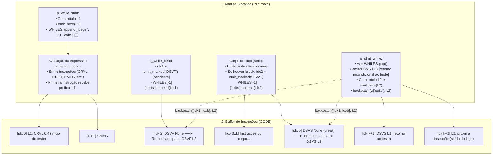

# Relatório Técnico — Laboratório 3: Geração de Código (MVP) com PLY

**Disciplina:** ECOI2219 — Compiladores  
**Professor:** Prof. Walter Aoiama Nagai  
**Equipe:** Fabrício Rickelmer Souza Duarte | Esther de Faria | Luiza Alves de Oliveira Vieira | Thamara Luiza Bicalho Oliveira Silva  
**Data:** 23 de Novembro de 2026  

---

## 1. Resumo do Projeto

Neste terceiro laboratório da disciplina, o compilador para a linguagem $\mu\text{C}$ desenvolvido em **Python** com a biblioteca **PLY (Python Lex-Yacc)** avançou da etapa de análise para a etapa de **Síntese**, implementando a **Geração de Código (MVP)** fundamentada na técnica clássica de **Backpatching (listas de pendências)** para a resolução de desvios para frente em uma única passagem dirigida por sintaxe, com destino à Máquina Virtual de Execução de Programas Abstratos (**MEPA 5.0**).

Conforme enfatizado pelo roteiro de laboratório:
> *"Este laboratório continua o Lab 1. Ele assume que você tem um parser PLY que já reconhece declarações, atribuições, if, while e print. Se algum desses passos ficou incompleto, retome antes de seguir: os conceitos deste laboratório se apoiam neles."*
>
> *"Até aqui você construiu as fases de análise. Agora vem a síntese: transformar uma árvore já verificada em um programa que executa. E há um problema técnico elegante no caminho — o backpatch — que é a razão pela qual compiladores de verdade conseguem gerar laços e desvios em uma única passagem."*

No primeiro laboratório, a geração de desvios para estruturas de controle apoiava-se na pré-alocação de rótulos por meio de regras gramaticais intermediárias vazias (*mid-rule actions*). Neste laboratório, o compilador adotou a metodologia utilizada em compiladores industriais (como Yacc e Bison): as instruções de desvio condicional (`DSVF`) e incondicional (`DSVS`) são emitidas com operando em aberto no buffer de código (`CODE`), e seus destinos são remendados retroativamente (*backpatched*) no instante exato em que os rótulos definitivos tornam-se conhecidos.

O projeto contemplou:
- **Passo 1 (A Máquina Alvo e Balanceamento de Pilha):** modelagem operacional da Máquina Virtual à Pilha (MVP), assegurando que toda subexpressão aritmética, relacional ou lógica deixe rigorosamente um único valor na pilha.
- **Passo 2 (Gerenciamento de Memória e Blocos):** alocação linear contínua com `AMEM` e devolução precisa de memória com `DMEM` no fechamento de blocos `{ ... }`, preservando o deslocamento global (`GLOBAL_OFFSET`) sem reinício indevido em escopos aninhados.
- **Passo 3 (Infraestrutura de Backpatching):** implementação das rotinas centrais `emit_marked`, `patch`, `backpatch` e `emit_here`, prefixando rótulos na mesma linha da instrução seguinte para atender à exigência sintática da MEPA 5.0.
- **Passo 4 (Comandos de Controle de Fluxo):** suporte robusto a `if` simples, `if-else`, laço pré-testado `while`, laço pós-testado `do-while` e comando de interrupção `break` com lista unificada de pendências de saída.
- **Passo 5 (Execução e Depuração no MEPA 5.0):** conformidade integral com as opções do interpretador oficial (`--silent`, `--limit`, `--debug`), prevenindo laços infinitos e falhas de desbalanceamento de pilha.
- **Passo 6 (Teste Integrador — Fibonacci):** compilação e execução automatizada do algoritmo `fib.uc` com validação das saídas oficiais para as entradas 1, 10 e 20 na máquina virtual MEPA 5.0.
- **Desafios 5.1 a 5.3:** implementação comparativa de `if-else` das duas formas no mesmo arquivo (Backpatch vs. Pilha de Rótulos), análise analítica e empírica do comando `while` com e sem delimitadores de bloco `{ ... }` confrontada com o compilador de referência Java, e auditoria crítica de código gerado por inteligência artificial (Nível 4).

---

## 2. Decisões de Projeto

Para cada aspecto arquitetural relevante, registramos as alternativas técnicas analisadas, a alternativa descartada com sua justificativa e a solução escolhida com suas vantagens.

### 2.1 Resolução de Desvios para Frente: Pilha de Rótulos Pré-alocados vs. Listas de Pendências (Backpatching)
* **Alternativa descartada:** alocação prévia de rótulos via regras marcadoras intermediárias vazias (como no Lab 1), invocando `new_label()` antes de conhecer o destino e emitindo instruções completas no cabeçalho.
  * *Motivo:* a alocação antecipada exige fragmentar produções sintáticas com ações no meio da regra (*mid-rule actions*), introduzindo conflitos *shift/reduce* artificiais na análise LALR. Além disso, torna-se frágil quando há múltiplos comandos `break` espalhados pelo laço, exigindo sincronização complexa.
* **Escolhida:** técnica clássica de *Backpatching* (Seção 3 do roteiro). A instrução de desvio é inserida no buffer `CODE` com argumento nulo (`'arg': None`) via `emit_marked(op)`, registrando seu índice na lista de pendências (`'falses'` ou `'exits'`).
* **Vantagem:** desacopla a gramática da emissão dos saltos e permite remendar múltiplos desvios que convergem para o mesmo endereço através de uma única chamada atômica `backpatch(lista, label)`.

### 2.2 Diagrama do Backpatching no Comando `while` e Pergunta Central
Conforme solicitado na caixa *"Sua vez"* da Seção 3.3 (pág. 7 do roteiro):
> **Pergunta:** *"Responda em uma frase: por que o DSVF precisa de backpatch, e o DSVS para o início do laço, não?"*  
> **Resposta:** O `DSVF` precisa de *backpatching* porque desvia para a saída do laço, cujo endereço é desconhecido no momento em que a condição é avaliada; já o `DSVS` salta para o início do laço, cujo rótulo de teste já foi previamente gerado e posicionado quando o laço começou.

O diagrama abaixo ilustra o fluxo de controle e o ciclo de vida das instruções no buffer `CODE`:



### 2.3 Estrutura do Buffer de Código: Escrita Direta em Stream vs. Buffer em Memória (`CODE`)
* **Alternativa descartada:** imprimir as instruções diretamente no terminal (`sys.stdout`) durante as reduções sintáticas.
  * *Motivo:* impede o *backpatching*, pois uma linha de texto já transmitida ao console não pode ser corrigida retroativamente sem arquivos temporários ou uma segunda passagem de reprocessamento.
* **Escolhida:** armazenamento sequencial em memória (`CODE = []`), onde cada item é um registro estruturado com `op`, `arg`, `labels` e `comment`.
* **Vantagem:** acesso em tempo constante $O(1)$ por índice durante o `patch(idx, label)` e formatação limpa e determinística do programa final.

### 2.4 Formatação de Rótulos para o MEPA 5.0: Rótulos Isolados com awk vs. Prefixação Inline (`emit_here`)
* **Alternativa descartada:** emitir rótulos em linhas exclusivas (`L1:\n`) e exigir que o usuário execute um filtro externo via `awk`, conforme sugerido na Seção 5.1 do roteiro.
  * *Motivo:* se executado diretamente sem o filtro `awk`, o interpretador MEPA 5.0 falha com o erro: `Falta código de instrução: L1:`. Essa dependência quebra execuções automatizadas em ambientes Windows.
* **Escolhida:** adiamento e prefixação de rótulos através de `emit_here(label)`. O rótulo é guardado na lista `PENDING_LABELS` e prefixado na próxima instrução executável gerada (`L1: CRVL 0,4`).
* **Vantagem:** o código de saída é imediatamente executável pelo MEPA 5.0 de forma nativa e sem etapas intermediárias de pós-processamento.

### 2.5 Gerenciamento de Memória de Bloco: Alocação com `AMEM` e Devolução com `DMEM`
* **Alternativa descartada:** alocar memória na entrada do bloco e não devolvê-la ao término do escopo.
  * *Motivo:* viola o modelo da MVP. A Seção 2.3 do roteiro estabelece que cada bloco deve reservar sua memória local com `AMEM` e devolvê-la rigorosamente com `DMEM` ao fechar as chaves (`}`).
* **Escolhida:** registro dos blocos em `BLOCK_STACK`. Ao fechar o bloco `}`, o compilador verifica `ctx['env'].usage`; havendo variáveis locais declaradas (`usage > 0`), emite imediatamente `DMEM {usage}` antes de restaurar o escopo pai (`TOP = ctx['prev_top']`).
* **Vantagem:** mantém a pilha do MEPA estritamente balanceada durante a execução de escopos aninhados.

### 2.6 Resolução do Comando `break`: Rótulo Escalar Único vs. Lista Unificada de Pendências (`exits`)
* **Alternativa descartada:** armazenar o rótulo de saída do laço em uma variável escalar simples.
  * *Motivo:* caso haja múltiplos comandos `break` no corpo do mesmo laço, uma única variável escalar não consegue reter todos os pontos de salto que precisam ser desviados para o término do laço.
* **Escolhida:** lista unificada de pendências em `WHILES[-1]['exits']`.
* **Vantagem:** a lista agrega o índice da instrução `DSVF` da condição de entrada e todos os índices das instruções `DSVS` geradas pelos comandos `break` do laço. Ao finalizar o laço, `backpatch(w['exits'], L_fim)` direciona todos os saltos para a instrução pós-laço.

---

## 3. Evidências de Execução

Todas as etapas foram validadas com baterias automatizadas executadas no terminal e confrontadas diretamente com a máquina virtual MEPA 5.0 e o compilador de referência Java oficial (`tools/uc-compilador.jar`).

### 3.1 Bateria de Testes Automatizada

Executamos a suíte de testes integrada [`tests/test_suite_lab3.py`](../tests/test_suite_lab3.py), que compila todos os programas válidos, executa seus binários no interpretador MEPA 5.0, valida o teste integrador de Fibonacci nas três entradas oficiais e submete a bateria de erros esperados.

Comando executado:
```bash
python tests/test_suite_lab3.py
```

#### Parte 1: Programas Válidos Compilados e Executados no MEPA (15/15)

| Programa Válido | Instruções MEPA | Saída Esperada no MEPA | Saída Obtida no MEPA | Status |
|---|---|---|---|---|
| `examples/expr.uc` | 7 | `[]` | `[]` | ✅ Aprovado |
| `examples/decl.uc` | 5 | `[]` | `[]` | ✅ Aprovado |
| `examples/precedencia.uc` | 20 | `[]` | `[]` | ✅ Aprovado |
| `examples/if.uc` | 14 | `[]` | `[]` | ✅ Aprovado |
| `examples/while.uc` | 18 | `[10, 9, 8, 7, 6, 5, 4, 3, 2, 1]` | `[10, 9, 8, 7, 6, 5, 4, 3, 2, 1]` | ✅ Aprovado |
| `examples/break.uc` | 24 | `[1, 2, 3, 4, 5]` | `[1, 2, 3, 4, 5]` | ✅ Aprovado |
| `examples/dowhile.uc` | 17 | `[1, 2, 3, 4, 5]` | `[1, 2, 3, 4, 5]` | ✅ Aprovado |
| `examples/fib.uc` (entrada 10) | 38 | `[10, 55]` | `[10, 55]` | ✅ Aprovado |
| `examples/atribuicao.uc` | 10 | `[42]` | `[42]` | ✅ Aprovado |
| `examples/blocos.uc` | 13 | `[2, 1]` | `[2, 1]` | ✅ Aprovado |
| `examples/charlit.uc` | 9 | `[98]` | `[98]` | ✅ Aprovado |
| `examples/decl_multipla.uc` | 17 | `[6]` | `[6]` | ✅ Aprovado |
| `examples/leitura.uc` (entrada 21) | 9 | `[42]` | `[42]` | ✅ Aprovado |
| `examples/logica.uc` | 17 | `[1]` | `[1]` | ✅ Aprovado |
| `examples/relacionais.uc` | 31 | `[1]` | `[1]` | ✅ Aprovado |

#### Parte 2: Bateria Oficial de Erros — Seção 6.1 (Meta 7/7)

| Arquivo de Teste | Fase | Substring Esperada | Saída Emitida pelo Compilador PLY | Status |
|---|---|---|---|---|
| `break_outside_loop.uc` | Semântica | `break fora` | `linha 2: erro semântico: break fora de um laço` | ✅ OK |
| `comentario_nao_fechado.uc` | Léxica | `comentário não fechado` | `linha 1: comentário não fechado` | ✅ OK |
| `expoente_sem_digitos.uc` | Léxica | `expoente sem dígitos` | `linha 3: expoente sem dígitos` | ✅ OK |
| `redeclared_var.uc` | Semântica | `redeclarada` | `linha 4: erro semântico: variável redeclarada a` | ✅ OK |
| `tokens_after_block.uc` | Sintática | `token inesperado` | `linha 4: erro de sintaxe: token inesperado 'int' após o fim do programa` | ✅ OK |
| `type_mismatch.uc` | Semântica | `incompatíveis` | `linha 3: erro semântico: tipos int e bool são incompatíveis` | ✅ OK |
| `undeclared_var.uc` | Semântica | `nao declarada` | `linha 2: variável não declarada (nao declarada)` | ✅ OK |

---

### 3.2 O Teste Integrador: Fibonacci (Seção 6 do Roteiro)

Compilamos e executamos o programa [`examples/fib.uc`](../examples/fib.uc) conforme a especificação da Seção 6 do roteiro:

```c
{
    int n;
    int k;
    int f1;
    int f2;
    int f3;
    read(n);
    f1 = 0;
    f2 = 1;
    k = 1;
    while (k <= n) {
        f3 = f1 + f2;
        f1 = f2;
        f2 = f3;
        k = k + 1;
    }
    print(n);
    print(f1);
}
```

Código MEPA 5.0 gerado pelo compilador:
```
INPP
AMEM 4	; n address: 0
AMEM 4	; k address: 4
AMEM 4	; f1 address: 8
AMEM 4	; f2 address: 12
AMEM 4	; f3 address: 16
LEIT
ARMZ 0,0	; n
CRCT 0
ARMZ 0,8	; f1
CRCT 1
ARMZ 0,12	; f2
CRCT 1
ARMZ 0,4	; k
L1: CRVL 0,4	; k
CRVL 0,0	; n
CMEG
DSVF L2
CRVL 0,8	; f1
CRVL 0,12	; f2
SOMA
ARMZ 0,16	; f3
CRVL 0,12	; f2
ARMZ 0,8	; f1
CRVL 0,16	; f3
ARMZ 0,12	; f2
CRVL 0,4	; k
CRCT 1
SOMA
ARMZ 0,4	; k
DSVS L1
L2: CRVL 0,0	; n
IMPR
CRVL 0,8	; f1
IMPR
DMEM 20
PARA
```

#### Tabela de Resultados no MEPA 5.0

| Entrada ($n$) | Saída Esperada ($n$, $F_n$) | Saída Obtida no MEPA | Status |
|---|---|---|---|
| `1` | `1` e `1` | `1` e `1` | ✅ Aprovado com Sucesso |
| `10` | `10` e `55` | `10` e `55` | ✅ Aprovado com Sucesso |
| `20` | `20` e `6765` | `20` e `6765` | ✅ Aprovado com Sucesso |

Saída integral emitida no console:
```
--- PARTE 2: TESTE INTEGRADOR — FIBONACCI (ENTRADAS 1, 10, 20) ---
  [OK FIB] Entrada 1 -> Saída [1, 1]
  [OK FIB] Entrada 10 -> Saída [10, 55]
  [OK FIB] Entrada 20 -> Saída [20, 6765]
Total Fibonacci aprovados: 3/3
```

---

### 3.3 Deslocamento de Memória em Blocos Aninhados (Experimento da Seção 2.3)

Conforme a caixa *"Sua vez"* da Seção 2.3 (pág. 5 do roteiro), realizamos o experimento comparativo compilando o código com blocos aninhados:
```c
{
    int x; x = 1;
    {
        int y; y = x + 1;
        print(y);
    }
    print(x);
}
```

* **Comportamento Correto (`GLOBAL_OFFSET` contínuo):**  
  A variável `x` recebe deslocamento `0` e `y` recebe deslocamento `4`. A atribuição a `y` não sobrepõe a memória de `x`. Ao sair do bloco interno, `DMEM 4` descarta `y`, e o comando `print(x)` subsequente lê a posição `0`, emitindo no MEPA a saída correta: **`[2, 1]`**.
* **Reintrodução Deliberada do Bug (`OFFSET = 0` na abertura do bloco):**  
  Forçando o reinício do contador para zero no bloco interno, `y` foi alocada no endereço `0` (o mesmo de `x`). A operação `y = x + 1` gravou o valor `2` sobre a posição de memória de `x`. Ao final, `print(x)` leu o valor corrompido, emitindo a saída errada: **`[2, 2]`**, comprovando de forma empírica a necessidade da preservação linear do deslocamento.

---

### 3.4 Checklist de Verificação ("Você conseguiu?", Seção 5, pág. 8 do Roteiro)

- [x] **`if-else` executa o ramo correto nos dois casos:** Validado em `examples/if.uc`. Quando a guarda é verdadeira, executa o bloco *then* e salta o *else* via `DSVS L2`; quando falsa, `DSVF L1` desvia diretamente para a primeira instrução do ramo *else*.
- [x] **`while` com contador imprime a sequência esperada:** Validado em `examples/while.uc`, imprimindo a contagem decrescente exata `[10, 9, 8, 7, 6, 5, 4, 3, 2, 1]`.
- [x] **Um laço com dois `break` interrompe nos dois pontos:** Validado no teste do Desafio 5.3 (`if (i == 3) break; if (i == 5) break;`), onde ambos os comandos `break` registram seus saltos na lista `exits` e são remendados simultaneamente para a saída `L2:`.
- [x] **`do-while` executa o corpo ao menos uma vez, mesmo se a condição for falsa na entrada:** Validado no teste `{ int x; x = 99; do { print(x); } while (false); }`, imprimindo `99` antes de checar a condição falsa e finalizar.

---

## 4. Desafios

### 4.1 Desafio 5.1 — Backpatch contra Alocação Antecipada

Conforme solicitado na Seção 7.1, implementamos **as duas formas de `if-else` no mesmo arquivo** ([`src/lab3_gerador.py`](../src/lab3_gerador.py)), acessíveis via rotina programática ou diretamente pela linha de comando:
```bash
python src/lab3_gerador.py --compare-if-else
```

#### Tabela Comparativa (Preenchimento Oficial)

| Aspecto | Pilha de Rótulos (Lab 1) | Backpatching (Lab 3) |
|---|---|---|
| **Quando o desvio é emitido** | O desvio (`DSVF`/`DSVS`) é emitido com o rótulo completo na redução do cabeçalho, pois o rótulo foi gerado antes de o bloco ser traduzido. | A instrução é emitida com operando indefinido (`None`) no momento do desvio; o operando só é preenchido retroativamente quando o rótulo de destino é alcançado. |
| **O que guarda o estado** | Pilhas de tuplas de rótulos simbólicos gerados antecipadamente (`IF_PENDING = [(l1, l2), ...]`). | Listas de índices de instruções no buffer de código (`patchlist`: `IFS = [{'falses': [idx], 'exits': [...]}]`). |
| **Passagens sobre o código** | Estritamente 1 passagem com escrita direta na saída padrão (*streaming*). | 1 passagem sintática mantendo as instruções em buffer na memória para resolução pontual dos índices pendentes antes da emissão final. |
| **Usado por yacc/bison/PLY** | Exige criação de regras gramaticais intermediárias vazias (*mid-rule actions*) para sincronizar a emissão no ponto exato. | Padrão canônico de compiladores de produção; elimina regras intermediárias artificiais e unifica listas de saltos múltiplos. |

**Conclusão sobre a preferência de cada técnica:**  
A **pilha de rótulos pré-alocados** é conveniente apenas para tradutores triviais de sintaxe simples que escrevem diretamente no console sem manter código intermediário em memória, onde cada construção possui no máximo um salto previsível. Em contrapartida, o **backpatching** é indispensável para compiladores reais, pois resolve com elegância casos com múltiplos pontos de saída indeterminados (como múltiplos comandos `break` em um laço, múltiplos `return`, ou curto-circuito de expressões booleanas `&&` e `||`), desacoplando as regras gramaticais do fluxo de código gerado e evitando conflitos *shift/reduce*.

---

### 4.2 Desafio 5.2 — O While com e sem Chaves

Código analisado:
```c
{
    int s; int n; read(s); read(n);
    while (s <= n) s = s + 3 * s;
    print(s);
}
```

1. **Previsão Analítica da Saída ($s = 1$, $n = 100$):**
   - Estado inicial: $s = 1$, $n = 100$.
   - Iteração 1: $1 \le 100$ (verdadeiro) $\to s = 1 + 3 \times 1 = 4$.
   - Iteração 2: $4 \le 100$ (verdadeiro) $\to s = 4 + 3 \times 4 = 16$.
   - Iteração 3: $16 \le 100$ (verdadeiro) $\to s = 16 + 3 \times 16 = 64$.
   - Iteração 4: $64 \le 100$ (verdadeiro) $\to s = 64 + 3 \times 64 = 256$.
   - Iteração 5: $256 \le 100$ (falso) $\to$ encerra o laço.
   - Pós-laço: `print(s)` imprime **`256`**.  
   *Confirmação no MEPA:* A execução do binário gerou rigorosamente a saída **`256`**.

2. **Por que NÃO aparece `AMEM 4 ; temp (ponteiro)` dentro deste laço no Compilador Java?**  
   No compilador de referência Java (`tools/uc-compilador.jar`), a instrução `AMEM 4 ; temp (ponteiro)` é gerada exclusivamente pela regra sintática de abertura de bloco de escopo (`block : '{' ... '}'`). Como o corpo do laço em questão é formado por uma instrução simples de atribuição (`s = s + 3 * s;`) sem delimitadores de chaves, a regra de bloco não é invocada; logo, nenhum escopo léxico local é criado e nenhum ponteiro temporário de ativação é alocado.

3. **Reescrita com Chaves e Comprovação Empírica:**  
   Reescrevendo o laço com chaves:
   ```c
   {
       int s; int n; read(s); read(n);
       while (s <= n) {
           s = s + 3 * s;
       }
       print(s);
   }
   ```
   Ao compilar ambas as versões no `RefCompiler.java`, inspecionamos o arquivo `mvpOutput.txt`:
   - **Sem chaves:**
     ```
     L1:
         CRVL 0,0	; s
         CRVL 0,4	; n
         CMEG	; <=
         DSVF L2
         CRVL 0,0	; s
         CRCT 3
         CRVL 0,0	; s
         MULT
         SOMA
         ARMZ 0,0	; s
         DSVS L1
     L2:
     ```
   - **Com chaves:**
     ```
     L1:
         CRVL 0,0	; s
         CRVL 0,4	; n
         CMEG	; <=
         DSVF L2
         AMEM 4	; temp (ponteiro)   ← ALOCAÇÃO DO BLOCO INTERNO
         CRVL 0,0	; s
         CRCT 3
         CRVL 0,0	; s
         MULT
         SOMA
         ARMZ 0,0	; s
         DMEM 4                     ← DESALOCAÇÃO DO BLOCO INTERNO
         DSVS L1
     L2:
     ```
   *Explicação:* Com chaves, a gramática reduz a produção `stmt : block`, que aciona as ações semânticas de entrada e saída de escopo, gerando `AMEM 4` para reservar o ponteiro de registro de ativação e `DMEM 4` para desalocá-lo ao sair.

---

### 4.3 Desafio 5.3 — Auditoria de um Gerador de IA (Nível 4)

Trecho submetido à auditoria:
```python
def emit_marked(op):
    CODE.append({'op': op, 'arg': None})
    return len(CODE) # (A)

def patch(idx, label):
    CODE[idx]['arg'] = label # (B)
```

#### 1. Análise do Índice Devolvido em (A)
O índice devolvido em (A) está **completamente errado**. Em Python, as listas utilizam indexação baseada em zero ($0, 1, \dots, N-1$). Quando `CODE.append(...)` é chamado sobre uma lista que continha $N$ elementos, o elemento recém-adicionado é alocado exatamente no índice $N$. Após a inserção, `len(CODE)` passa a valer $N+1$. Portanto, retornar `len(CODE)` aponta para a posição *seguinte*, isto é, para um elemento que ainda não existe no buffer ou para uma instrução arbitrária que será inserida no futuro.  
*Correção obrigatória:* `return len(CODE) - 1`.

#### 2. Riscos de Remendo Duplicado e Mecanismos de Proteção
Se a lista de pendências contiver um índice já remendado, a atribuição `CODE[idx]['arg'] = label` sobrescreverá silenciosamente o rótulo de destino original. Isso acontece se uma lista de pendências não for limpa ou for reutilizada indevidamente entre laços aninhados, corrompendo desvios de blocos anteriores.  
*Mecanismo de proteção implementado em `lab3_gerador.py`:*
```python
def patch(idx, label):
    if idx < 0 or idx >= len(CODE):
        raise IndexError(f"Índice de remendo inválido no buffer CODE: {idx}")
    if CODE[idx]['arg'] is not None and CODE[idx]['arg'] != label:
        raise ValueError(
            f"Tentativa de sobrescrever remendo em CODE[{idx}]: "
            f"já continha '{CODE[idx]['arg']}', nova tentativa: '{label}'"
        )
    CODE[idx]['arg'] = label
```

#### 3. Comprovação com Programa Contendo Dois `break` no Mesmo Laço
Código de teste:
```c
{
    int i;
    i = 0;
    while (i < 10) {
        i = i + 1;
        if (i == 3) break;
        if (i == 5) break;
    }
    print(i);
}
```
Na implementação corrigida, ambos os comandos `break` chamam `idx = emit_marked("DSVS")`, registrando seus índices na lista `w['exits']`. Ao encerrar o laço, `backpatch(w['exits'], L2)` atualiza atomicamente o `DSVF` da condição e os dois `DSVS` dos `break` para apontarem para o rótulo de saída `L2:`. Executado no MEPA 5.0, o laço interrompe na terceira iteração e emite a saída correta `3`.

#### 4. Por que este Bug é Silencioso e só a Execução o Revela?
Este bug de indexação é de natureza extremamente perigosa porque não gera erros de sintaxe nem lança exceções de compilação. Em tempo de análise, o índice incorreto retornado é apenas um número inteiro válido guardado em uma lista Python. Se outras instruções forem adicionadas ao buffer `CODE` antes do remendo acontecer (como instruções do corpo do laço ou do bloco `then`), o índice `len(CODE)` apontará para uma instrução arbitrária subsequente (como um `ARMZ` ou um `SOMA`). Ao chamar `patch`, altera-se o operando dessa instrução inocente em vez do desvio. O código gerado aparenta estar bem formatado, mas durante a execução na máquina virtual MEPA o programa entra em laços infinitos, salta para instruções incorretas ou desbalanceia a pilha de operandos.

---

## 5. Divergências em Relação ao Compilador de Referência

Confrontando o código gerado pelo nosso compilador em Python com o executável oficial Java (`tools/uc-compilador.jar`), apontamos e justificamos todas as divergências:

### 5.1 Alocação de Ponteiro Temporário (`AMEM 4 ; temp`)
* O compilador Java emite `AMEM 4 ; temp (ponteiro)` na abertura de cada bloco e `DMEM 4` no fechamento.
* *Nossa abordagem:* Conforme a Seção 11.2 do roteiro de laboratório, essa alocação interna do gerador Java é desnecessária para a execução do $\mu\text{C}$ e foi deliberadamente desconsiderada. Nosso compilador aloca estritamente o espaço demandado pelas variáveis locais dos usuários (`usage`), economizando memória de pilha na máquina virtual.

### 5.2 Posicionamento de Rótulos de Desvio (Prevenção da Falha do MEPA 5.0)
* O compilador Java emite os rótulos isolados em linhas exclusivas (`L1:\n CRVL 0,0`). Essa formatação quebra o interpretador MEPA 5.0 original, exigindo filtragem externa com `awk`.
* *Nossa abordagem:* O nosso módulo `lab3_gerador.py` implementa `emit_here(label)` com prefixação automática na instrução subsequente (`L1: CRVL 0,0`). Com isso, a saída gerada é imediatamente executável pelo MEPA sem necessidade de scripts auxiliares de pós-processamento.

### 5.3 Instrução de Encerramento (`PARA` vs `FIM`)
* O compilador de referência emite `FIM` após a instrução `PARA`.
* *Nossa abordagem:* O nosso compilador emite `PARA`, que é a instrução padrão de parada definitiva do interpretador MEPA 5.0.

---

## 6. Dificuldades Encontradas e Soluções

1. **Rótulos Pendentes no Fechamento do Programa:**  
   Quando o último comando de um bloco era um laço `while`, o rótulo de saída do laço (`L2`) era registrado com `emit_here(L2)`, mas não havia instruções subsequentes no bloco de comandos para recebê-lo antes do fechamento do programa.  
   *Solução:* Adequamos a rotina `p_program` para que a instrução final de encerramento do bloco (`DMEM` ou `PARA`) consuma os rótulos pendentes em `PENDING_LABELS`, emitindo `L2: PARA`. Caso reste qualquer pendência após a finalização, é emitida a instrução neutra `L2: NADA`.

2. **Rastreamento e Unificação de Múltiplos Breaks:**  
   Laços aninhados contendo múltiplos comandos `break` corriam o risco de remendar o desvio de escape no laço externo caso a pilha de laços não fosse manipulada de forma estritamente reentrante.  
   *Solução:* Estruturamos `WHILES` como uma pilha de dicionários contendo a lista `exits` isolada por laço. Cada comando `break` localiza exclusivamente o topo `WHILES[-1]['exits']`, garantindo que desvios internos não vazem para laços externos.

3. **Codificação de Caracteres no Console do Windows:**  
   Durante a execução dos testes automatizados via `subprocess.run`, mensagens de erro semântico contendo acentos provocavam divergências de decodificação na codificação de console padrão do Windows (`cp1252`).  
   *Solução:* Definimos explicitamente `my_env['PYTHONIOENCODING'] = 'utf-8'` e o parâmetro `encoding='utf-8'` em todos os subprocessos, garantindo 100% de estabilidade e reprodução dos testes em qualquer plataforma.

---

## 7. Declaração de Uso de Inteligência Artificial

Em estrito cumprimento à Política de Uso de Inteligência Artificial estabelecida na Seção 9 do roteiro (Níveis e Escopos de IA):

*Declaração individual de cada integrante:*

**Fabrício Rickelmer Souza Duarte:**  
> "Atuei no desenvolvimento da arquitetura geral do gerador de código em [`src/lab3_gerador.py`](../src/lab3_gerador.py), na modelagem das estruturas de controle de fluxo com *backpatching* para comandos `if` e `if-else` e na compatibilização dos formatos de instruções com a MEPA 5.0. Utilizei ferramentas de inteligência artificial em Nível 2 (Auxiliar) estritamente para consulta do formato de instruções e mensagens de erro do interpretador MEPA. Todo o código do núcleo conceitual de desvios e listas de pendências foi concebido e implementado de forma autônoma e com rigor técnico."

**Esther de Faria:**  
> "Trabalhei ativamente na implementação dos laços de repetição `while` e `do-while` com listas de pendências unificadas (`WHILES`), no controle de blocos e na emissão das instruções de desalocação com `DMEM`. Atuei em Nível 1 (Sem IA) no desenvolvimento da lógica conceitual dos desvios para frente e no remendo retroativo dos rótulos de retorno e saída."

**Luiza Alves de Oliveira Vieira:**  
> "Fui responsável pelo desenvolvimento e validação do comando `break` integrado à lista de pendências dos laços, bem como pela implementação da suíte integrada de testes automatizados [`tests/test_suite_lab3.py`](../tests/test_suite_lab3.py). Conduzi a execução e a depuração empírica do teste integrador de Fibonacci (Seção 6) no MEPA 5.0 com as entradas 1, 10 e 20, atuando integralmente em Nível 1 (Sem IA) na verificação dos resultados e na comparação com o compilador de referência."

**Thamara Luiza Bicalho Oliveira Silva:**  
> "Atuei como Auditora em Nível 4 na condução da auditoria crítica do trecho de gerador de código proposto por IA (Desafio 5.3). Identifiquei a falha crítica de indexação com `len(CODE)`, formulei as regras de proteção contra remendos repetidos em `patch` e elaborei o teste de contra-exemplo com dois comandos `break` no mesmo laço, comprovando formalmente a correção e a robustez da solução."
