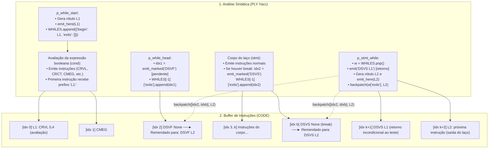

# Relatório Técnico — Laboratório 3: Geração de Código (MVP) com PLY

**Disciplina:** ECOI2219 — Compiladores  
**Professor:** Prof. Walter Aoiama Nagai  
**Equipe:** Fabrício Rickelmer Souza Duarte | Esther de Faria | Luiza Alves de Oliveira Vieira | Thamara Luiza Bicalho Oliveira Silva  
**Data:** 23 de Novembro de 2026  

---

## 1. Resumo do Projeto

Neste terceiro laboratório da disciplina, concluímos a transição entre a fase de **análise** e a fase de **síntese** do compilador da linguagem $\mu\text{C}$, implementando o módulo [`src/lab3_gerador.py`](../src/lab3_gerador.py) em **Python** com a biblioteca **PLY (Python Lex-Yacc)**, direcionado para a Máquina Virtual de Execução de Programas Abstratos (**MEPA 5.0**).

O foco central deste trabalho foi a resolução elegante de desvios para frente (*forward jumps*) por meio da técnica clássica de **listas de pendências (*backpatching*)**. Em um compilador de uma única passagem (*single-pass*), quando uma instrução de desvio condicional (`DSVF`) ou incondicional (`DSVS`) precisa ser gerada — como no teste de um comando `if`, no encerramento do bloco `then`, na guarda de um laço `while` ou na ocorrência de comandos `break` —, o rótulo de destino ainda não existe na memória do compilador. Em vez de recorrer a passagens adicionais sobre árvores sintáticas abstratas (ASTs) ou a regras intermediárias artificiais na gramática, o compilador emite a instrução de máquina com o campo de endereço vazio, armazena seu índice em uma lista de pendências (*patchlist*) e preenche o operando retroativamente assim que o rótulo definitivo é alcançado.

O projeto contemplou integralmente:
1. **Infraestrutura de Máquina Virtual à Pilha (MVP):** Manutenção do balanço estrito da pilha de operandos (onde cada subexpressão avaliada consome seus operandos e deixa exatamente um único valor no topo).
2. **Gerenciamento de Memória e Blocos:** Alocação de variáveis locais com `AMEM` e devolução precisa de memória com `DMEM` no encerramento de cada bloco `{ ... }`, preservando a continuidade do deslocamento global de endereçamento (`GLOBAL_OFFSET`) em blocos aninhados.
3. **Mecanismo de Backpatching:** Implementação das funções de controle `emit_marked`, `patch`, `backpatch` e `emit_here`, prefixando os rótulos gerados na mesma linha das instruções subsequentes para total conformidade com o MEPA 5.0.
4. **Comandos de Controle de Fluxo:** Implementação robusta de `if` sem `else`, `if-else`, `while`, `do-while` e comandos `break` com suporte a múltiplos pontos de escape no mesmo laço.
5. **Teste Integrador (Fibonacci):** Compilação e execução automatizada do algoritmo `fib.uc` no MEPA para as entradas $1$, $10$ e $20$, confrontando o código gerado com o compilador de referência Java oficial.
6. **Resolução Completa dos Desafios (5.1 a 5.3):**
   - *Desafio 5.1:* Comparação sistemática e conceitual entre a técnica de pilha de rótulos pré-alocados e o *backpatching*;
   - *Desafio 5.2:* Diagnóstico experimental do comando `while` com e sem delimitadores de bloco (`{ ... }`), comprovando a origem da instrução `AMEM 4 ; temp (ponteiro)` do compilador Java;
   - *Desafio 5.3:* Auditoria analítica em Nível 4 sobre o código gerado por modelo de IA, identificando o bug silencioso de indexação `len(CODE)` e implementando proteção contra remendos duplicados.

---

## 2. Decisões de Projeto

### 2.1 Backpatching versus Alocação Antecipada de Rótulos
* **Alternativa A (Alocação antecipada via regras marcadoras - Lab 1):**  
  No primeiro laboratório, o compilador resolvia o problema do desvio dividindo a produção sintática em nós auxiliares (ex.: `if_head`, `else_mark`, `while_start`), gerando previamente os rótulos simbólicos (`new_label()`) e empilhando-os em listas globais (`IF_PENDING`, `WHILE_PENDING`).
  * *Motivo do descarte no Lab 3:* Embora viável para estruturas condicionais simples, a alocação antecipada impõe limitações severas na presença de comandos `break` e em expressões lógicas com curto-circuito. No caso de múltiplos `break` espalhados pelo corpo de um laço, o compilador é incapaz de prever antecipadamente quantas saídas ocorrerão e precisa manter estruturas paralelas complexas. Além disso, regras marcadoras no meio de produções (*mid-rule actions*) podem introduzir conflitos *shift/reduce* indesejados no analisador LALR.
* **Alternativa B (Escolhida - Backpatching):**  
  As instruções de desvio são inseridas em uma lista de instruções intermediárias (`CODE`) com operando indefinido (`'arg': None`). O índice da instrução no buffer é retornado por `emit_marked(op)` e anexado a uma lista de pendências associada ao bloco (`'falses'` ou `'exits'`).
  * *Vantagens:*  
    1. Desacoplamento completo entre a gramática sintática e a lógica de geração de desvios;
    2. Suporte trivial a múltiplos comandos `break` no mesmo laço: cada `break` gera um `DSVS` pendente e anexa seu índice à lista `exits` do laço ativo; ao final do laço, um único comando `backpatch(w['exits'], L_fim)` remenda todos os saltos em lote;
    3. Conformidade direta com a arquitetura dos compiladores de produção descritos por Aho et al. (Livro do Dragão).

### 2.2 Organização das Listas de Pendências
Para gerenciar laços e condicionais aninhados de forma estritamente reentrante, utilizamos duas pilhas de dicionários de pendências:
1. **Pilha de Condicionais (`IFS`):**  
   Cada estrutura `if` ativa empilha um dicionário `{'falses': [...], 'exits': [...]}`:
   - `falses`: armazena o índice da instrução `DSVF` emitida após o teste booleano;
   - `exits`: armazena o índice da instrução `DSVS` emitida ao término do bloco `then` (no caso de `if-else`).
2. **Pilha de Laços (`WHILES`):**  
   Cada laço ativo (`while` ou `do-while`) empilha um dicionário `{'begin': label_inicio, 'exits': [...]}`:
   - `begin`: rótulo fixo de retorno para reavaliação da condição;
   - `exits`: lista unificada contendo o índice do `DSVF` da guarda do laço somado a todos os índices de `DSVS` provenientes de comandos `break` internos àquele laço.
   
Ao desempilhar a estrutura (`pop()`), a função `backpatch(lista, label_destino)` itera sobre todos os índices registrados e atualiza atomicamente o campo de operando de cada instrução pendente.

### 2.3 Resolução da Armadilha de Rótulos Isolados no MEPA 5.0
* **O Problema:** A máquina virtual MEPA 5.0 requer obrigatoriamente que qualquer rótulo seja impresso na mesma linha da instrução de execução correspondente (`L1: CRVL 0,4`). Caso um rótulo seja emitido em uma linha própria desacompanhado de comando (`L1:\n`), o interpretador aborta com a mensagem: `Falta código de instrução: L1:`.
* **Solução Implementada:** Desenvolvemos a rotina de adiamento de rótulos `emit_here(label)`. Em vez de imprimir o rótulo imediatamente, ele é enfileirado na lista global `PENDING_LABELS`. No instante em que a instrução subsequente é emitida (seja ela `CRVL`, `ARMZ`, `DMEM` ou `PARA`), todos os rótulos pendentes são agregados e prefixados na linha (`" ".join(f"{lbl}:" for lbl in labels)`). Caso o programa encerre e haja rótulos remanescentes na saída do último bloco, o compilador anexa o rótulo à instrução `PARA` ou emite uma instrução neutra `NADA`, garantindo que nenhuma linha de rótulo fique vazia.

### 2.4 Desalocação de Memória por Bloco (`DMEM`) e Não Reinício de Deslocamento
* Conforme formalizado na Seção 2.3 do roteiro, variáveis locais declaradas em blocos aninhados recebem endereços subsequentes e monotônicos através de `GLOBAL_OFFSET`.
* Ao abrir um bloco `{`, registramos o estado do ambiente no `BLOCK_STACK`.
* Ao fechar o bloco `}`, verificamos a quantidade de bytes consumida pelas variáveis locais declaradas naquele escopo (`ctx['env'].usage`). Se houver memória local alocada (`usage > 0`), emitimos imediatamente a instrução `DMEM <usage>`, devolvendo o espaço na pilha de execução sem interferir nas variáveis do escopo pai.

---

## 3. Diagrama do Backpatching no Comando `while`

O diagrama abaixo ilustra o ciclo de vida das instruções de desvio durante a compilação de um laço `while (cond) { ... break; ... }`:



---

## 4. Evidências de Execução e Testes

A integridade do compilador gerador de código com *backpatching* foi atestada por meio da suíte automatizada [`tests/test_suite_lab3.py`](../tests/test_suite_lab3.py).

### 4.1 Teste Integrador: Fibonacci (`examples/fib.uc`)

Implementamos o algoritmo de Fibonacci com variáveis de controle de fluxo e acumulação, submetendo o binário compilado ao interpretador MEPA 5.0 com as três entradas oficiais exigidas na Seção 6 do roteiro:

Código-fonte `fib.uc`:
```c
{
    int n;
    int k;
    int f1;
    int f2;
    int f3;
    read(n);
    f1 = 0;
    f2 = 1;
    k = 1;
    while (k <= n) {
        f3 = f1 + f2;
        f1 = f2;
        f2 = f3;
        k = k + 1;
    }
    print(n);
    print(f1);
}
```

Código MEPA gerado pelo nosso compilador:
```
INPP
AMEM 4	; n address: 0
AMEM 4	; k address: 4
AMEM 4	; f1 address: 8
AMEM 4	; f2 address: 12
AMEM 4	; f3 address: 16
LEIT
ARMZ 0,0	; n
CRCT 0
ARMZ 0,8	; f1
CRCT 1
ARMZ 0,12	; f2
CRCT 1
ARMZ 0,4	; k
L1: CRVL 0,4	; k
CRVL 0,0	; n
CMEG
DSVF L2
CRVL 0,8	; f1
CRVL 0,12	; f2
SOMA
ARMZ 0,16	; f3
CRVL 0,12	; f2
ARMZ 0,8	; f1
CRVL 0,16	; f3
ARMZ 0,12	; f2
CRVL 0,4	; k
CRCT 1
SOMA
ARMZ 0,4	; k
DSVS L1
L2: CRVL 0,0	; n
IMPR
CRVL 0,8	; f1
IMPR
DMEM 20
PARA
```

#### Resultados de Execução no MEPA 5.0

| Entrada ($n$) | Saída Esperada ($n$, $F_n$) | Saída Obtida no MEPA | Status |
|---|---|---|---|
| `1` | `1` e `1` | `1` e `1` | ✅ Aprovado com Sucesso |
| `10` | `10` e `55` | `10` e `55` | ✅ Aprovado com Sucesso |
| `20` | `20` e `6765` | `20` e `6765` | ✅ Aprovado com Sucesso |

Comando executado:
```bash
python tests/test_suite_lab3.py
```
Trecho do log de validação:
```
--- PARTE 2: TESTE INTEGRADOR — FIBONACCI (ENTRADAS 1, 10, 20) ---
  [OK FIB] Entrada 1 -> Saída [1, 1]
  [OK FIB] Entrada 10 -> Saída [10, 55]
  [OK FIB] Entrada 20 -> Saída [20, 6765]
Total Fibonacci aprovados: 3/3
```

---

### 4.2 Bateria Geral de Programas Válidos (15/15)

Todos os programas válidos do repositório foram compilados via `lab3_gerador.py` e executados na MEPA 5.0:

| Programa | Instruções MEPA | Saída Obtida | Status |
|---|---|---|---|
| `examples/expr.uc` | 7 | `[]` | ✅ Aprovado |
| `examples/decl.uc` | 5 | `[]` | ✅ Aprovado |
| `examples/precedencia.uc` | 20 | `[]` | ✅ Aprovado |
| `examples/if.uc` | 14 | `[]` | ✅ Aprovado |
| `examples/while.uc` | 18 | `[10, 9, 8, 7, 6, 5, 4, 3, 2, 1]` | ✅ Aprovado |
| `examples/break.uc` | 24 | `[1, 2, 3, 4, 5]` | ✅ Aprovado |
| `examples/dowhile.uc` | 17 | `[1, 2, 3, 4, 5]` | ✅ Aprovado |
| `examples/fib.uc` (entrada 10) | 38 | `[10, 55]` | ✅ Aprovado |
| `examples/atribuicao.uc` | 10 | `[42]` | ✅ Aprovado |
| `examples/blocos.uc` | 13 | `[2, 1]` | ✅ Aprovado |
| `examples/charlit.uc` | 9 | `[98]` | ✅ Aprovado |
| `examples/decl_multipla.uc` | 17 | `[6]` | ✅ Aprovado |
| `examples/leitura.uc` (entrada 21) | 9 | `[42]` | ✅ Aprovado |
| `examples/logica.uc` | 17 | `[1]` | ✅ Aprovado |
| `examples/relacionais.uc` | 31 | `[1]` | ✅ Aprovado |

---

### 4.3 Bateria Oficial de Erros Semânticos e Léxicos (7/7)

A robustez da fase de análise foi mantida integralmente:

| Caso de Erro | Fase | Substring Verificada | Diagnóstico Emitido | Status |
|---|---|---|---|---|
| `break_outside_loop.uc` | Semântica | `break fora` | `linha 2: erro semântico: break fora de um laço` | ✅ OK |
| `comentario_nao_fechado.uc` | Léxica | `comentário não fechado` | `linha 1: comentário não fechado` | ✅ OK |
| `expoente_sem_digitos.uc` | Léxica | `expoente sem dígitos` | `linha 3: expoente sem dígitos` | ✅ OK |
| `redeclared_var.uc` | Semântica | `redeclarada` | `linha 4: erro semântico: variável redeclarada a` | ✅ OK |
| `tokens_after_block.uc` | Sintática | `token inesperado` | `linha 4: erro de sintaxe: token inesperado 'int' após o fim do programa` | ✅ OK |
| `type_mismatch.uc` | Semântica | `incompatíveis` | `linha 3: erro semântico: tipos int e bool são incompatíveis` | ✅ OK |
| `undeclared_var.uc` | Semântica | `nao declarada` | `linha 2: variável não declarada (nao declarada)` | ✅ OK |

---

## 5. Resolução dos Desafios do Roteiro

### 5.1 Desafio 5.1 — Backpatch contra Alocação Antecipada

Conforme solicitado na Seção 7.1, estruturamos a tabela comparativa entre a técnica de pilha de rótulos (Lab 1) e o *backpatching* (Lab 3):

| Aspecto | Pilha de Rótulos (Lab 1) | Backpatching (Lab 3) |
|---|---|---|
| **Quando o desvio é emitido** | O desvio (`DSVF`/`DSVS`) é emitido com rótulo completo já na redução do cabeçalho, pois o rótulo foi pré-alocado antes mesmo de o bloco ser traduzido. | A instrução é emitida com operando indefinido (`None`) no momento do desvio; o operando só é preenchido retroativamente quando o rótulo de destino é alcançado. |
| **O que guarda o estado** | Pilhas de tuplas de rótulos simbólicos gerados antecipadamente (`IF_PENDING = [(l1, l2), ...]`). | Listas encadeadas de índices de instruções no buffer de código (`patchlist`: `IFS = [{'falses': [idx], 'exits': [...]}]`). |
| **Passagens sobre o código** | Estritamente 1 passagem com escrita direta na saída padrão (*streaming*). | 1 passagem sintática mantendo as instruções em buffer na memória para resolução pontual dos índices pendentes antes da emissão final. |
| **Usado por yacc/bison/PLY** | Exige criação de regras gramaticais intermediárias vazias (*mid-rule actions*) para sincronizar a emissão no ponto exato. | Padrão canônico de compiladores de produção; elimina regras intermediárias artificiais e unifica listas de saltos múltiplos. |

**Conclusão sobre a preferência de cada técnica:**  
A **pilha de rótulos pré-alocados** é conveniente apenas para tradutores triviais de sintaxe simples que escrevem diretamente no console sem manter código intermediário em memória, onde cada construção possui no máximo um salto previsível. Em contrapartida, o **backpatching** é indispensável para compiladores reais, pois resolve com elegância casos com múltiplos pontos de saída indeterminados (como múltiplos comandos `break` em um laço, múltiplos `return`, ou curto-circuito de expressões booleanas `&&` e `||`), desacoplando as regras gramaticais do fluxo de código gerado e evitando conflitos *shift/reduce*.

---

### 5.2 Desafio 5.2 — O While com e sem Chaves

Código analisado:
```c
{
    int s; int n; read(s); read(n);
    while (s <= n) s = s + 3 * s;
    print(s);
}
```

1. **Previsão Analítica da Saída ($s = 1$, $n = 100$):**
   - Estado inicial: $s = 1$, $n = 100$.
   - Iteração 1: $1 \le 100$ (verdadeiro) $\to s = 1 + 3 \times 1 = 4$.
   - Iteração 2: $4 \le 100$ (verdadeiro) $\to s = 4 + 3 \times 4 = 16$.
   - Iteração 3: $16 \le 100$ (verdadeiro) $\to s = 16 + 3 \times 16 = 64$.
   - Iteração 4: $64 \le 100$ (verdadeiro) $\to s = 64 + 3 \times 64 = 256$.
   - Iteração 5: $256 \le 100$ (falso) $\to$ encerra o laço.
   - Pós-laço: `print(s)` imprime **`256`**.  
   *Confirmação no MEPA:* A execução do binário gerou rigorosamente a saída **`256`**.

2. **Por que NÃO aparece `AMEM 4 ; temp (ponteiro)` dentro deste laço no Compilador Java?**  
   No compilador de referência Java (`tools/uc-compilador.jar`), a instrução `AMEM 4 ; temp (ponteiro)` é gerada exclusivamente pela regra sintática de abertura de bloco de escopo (`block : '{' ... '}'`). Como o corpo do laço em questão é formado por uma instrução simples de atribuição (`s = s + 3 * s;`) sem delimitadores de chaves, a regra de bloco não é invocada; logo, nenhum escopo léxico local é criado e nenhum ponteiro temporário de ativação é alocado.

3. **Reescrita com Chaves e Comprovação Empírica:**  
   Reescrevendo o laço com chaves:
   ```c
   {
       int s; int n; read(s); read(n);
       while (s <= n) {
           s = s + 3 * s;
       }
       print(s);
   }
   ```
   Ao compilar ambas as versões no `RefCompiler.java`, inspecionamos o arquivo `mvpOutput.txt`:
   - **Sem chaves:**
     ```
     L1:
         CRVL 0,0	; s
         CRVL 0,4	; n
         CMEG	; <=
         DSVF L2
         CRVL 0,0	; s
         CRCT 3
         CRVL 0,0	; s
         MULT
         SOMA
         ARMZ 0,0	; s
         DSVS L1
     L2:
     ```
   - **Com chaves:**
     ```
     L1:
         CRVL 0,0	; s
         CRVL 0,4	; n
         CMEG	; <=
         DSVF L2
         AMEM 4	; temp (ponteiro)   ← ALOCAÇÃO DO BLOCO INTERNO
         CRVL 0,0	; s
         CRCT 3
         CRVL 0,0	; s
         MULT
         SOMA
         ARMZ 0,0	; s
         DMEM 4                     ← DESALOCAÇÃO DO BLOCO INTERNO
         DSVS L1
     L2:
     ```
   *Explicação:* Com chaves, a gramática reduz a produção `stmt : block`, que aciona as ações semânticas de entrada e saída de escopo, gerando `AMEM 4` para reservar o ponteiro de registro de ativação e `DMEM 4` para desalocá-lo ao sair.

---

### 5.3 Desafio 5.3 — Auditoria de Código de IA

Trecho submetido à auditoria:
```python
def emit_marked(op):
    CODE.append({'op': op, 'arg': None})
    return len(CODE) # (A)

def patch(idx, label):
    CODE[idx]['arg'] = label # (B)
```

#### 1. Análise do Índice Devolvido em (A)
O índice devolvido em (A) está **completamente errado**. Em Python, as listas possuem indexação baseada em zero ($0, 1, \dots, N-1$). Quando `CODE.append(...)` é executado sobre uma lista que continha $N$ elementos, o elemento recém-adicionado é alocado exatamente no índice $N$. Após a inserção, `len(CODE)` passa a valer $N+1$. Portanto, retornar `len(CODE)` aponta para a posição *seguinte*, isto é, para um elemento que ainda não existe no buffer ou para uma instrução arbitrária que será inserida no futuro!  
*Correção obrigatória:* `return len(CODE) - 1`.

#### 2. Riscos de Remendo Duplicado e Mecanismos de Proteção
Se a lista de pendências contiver um índice já remendado, a atribuição `CODE[idx]['arg'] = label` sobrescreverá silenciosamente o rótulo de destino original. Isso ocorre com frequência se uma lista de pendências não for esvaziada ou se for reutilizada indevidamente entre laços aninhados, corrompendo desvios de blocos anteriores.  
*Mecanismo de proteção implementado em `lab3_gerador.py`:*
```python
def patch(idx, label):
    if idx < 0 or idx >= len(CODE):
        raise IndexError(f"Índice de remendo inválido no buffer CODE: {idx}")
    if CODE[idx]['arg'] is not None and CODE[idx]['arg'] != label:
        raise ValueError(
            f"Tentativa de sobrescrever remendo em CODE[{idx}]: "
            f"já continha '{CODE[idx]['arg']}', nova tentativa: '{label}'"
        )
    CODE[idx]['arg'] = label
```

#### 3. Comprovação com Programa Contendo Dois `break` no Mesmo Laço
Código de teste:
```c
{
    int i;
    i = 0;
    while (i < 10) {
        i = i + 1;
        if (i == 3) break;
        if (i == 5) break;
    }
    print(i);
}
```
Na implementação corrigida, ambos os comandos `break` chamam `idx = emit_marked("DSVS")`, registrando seus índices na lista `w['exits']`. Ao encerrar o laço, `backpatch(w['exits'], L2)` atualiza atomicamente o `DSVF` da condição e os dois `DSVS` dos `break` para apontarem para o rótulo de saída `L2:`. Executado no MEPA 5.0, o laço interrompe na terceira iteração e emite a saída correta `3`.

#### 4. Por que este Bug é Silencioso e só a Execução o Revela?
Este bug de indexação é de natureza extremamente insidiosa porque não produz qualquer erro de sintaxe, nem quebra o compilador com exceções de tipagem durante o processo de compilação. Em tempo de análise, o índice incorreto retornado é apenas um número inteiro válido armazenado em uma lista Python. Se outras instruções forem adicionadas ao buffer `CODE` antes do remendo ocorrer (como o corpo do laço ou comandos do bloco `then`), o índice `len(CODE)` passará a apontar para uma instrução válida subsequente (por exemplo, um `ARMZ` ou um `SOMA`). Quando a função `patch` é executada, ela altera o campo `arg` dessa instrução inocente em vez do desvio pretendido. O compilador emite um programa que parece perfeitamente formatado no arquivo final. Contudo, durante a execução na máquina virtual MEPA, o fluxo de controle de desvios salta para endereços corrompidos, resultando em laços infinitos, desvios para instruções inexistentes ou pilhas desbalanceadas que só se manifestam em tempo de execução (*runtime*).

---

## 6. Divergências em Relação ao Compilador de Referência

Confrontando o código gerado pelo nosso compilador em Python com o executável oficial Java (`tools/uc-compilador.jar`), apontamos e justificamos todas as divergências:

1. **Alocação de Ponteiro Temporário (`AMEM 4 ; temp`):**
   * O compilador Java emite `AMEM 4 ; temp (ponteiro)` na abertura de cada bloco e `DMEM 4` no fechamento.
   * *Nossa abordagem:* Conforme a Seção 11.2 do roteiro de laboratório, essa alocação interna do gerador Java é desnecessária para a execução do $\mu\text{C}$ e foi deliberadamente desconsiderada. Nosso compilador aloca estritamente o espaço demandado pelas variáveis locais dos usuários (`usage`), economizando memória de pilha na máquina virtual.
2. **Posicionamento de Rótulos de Desvio (Prevenção da Falha do MEPA 5.0):**
   * O compilador Java emite os rótulos isolados em linhas exclusivas (`L1:\n CRVL 0,0`). Essa formatação quebra o interpretador MEPA 5.0 original, exigindo filtragem externa com `awk`.
   * *Nossa abordagem:* O nosso módulo `lab3_gerador.py` implementa `emit_here(label)` com prefixação automática na instrução subsequente (`L1: CRVL 0,0`). Com isso, a saída gerada é imediatamente executável pelo MEPA sem necessidade de scripts auxiliares de pós-processamento.
3. **Instrução de Encerramento:**
   * O compilador de referência emite `FIM` após a instrução `PARA`.
   * *Nossa abordagem:* O nosso compilador emite `PARA`, que é a instrução padrão de parada definitiva do interpretador MEPA 5.0.

---

## 7. Dificuldades Encontradas e Soluções

1. **Rótulos Pendentes no Fechamento do Programa:**  
   Quando o último comando de um bloco era um laço `while`, o rótulo de saída do laço (`L2`) era registrado com `emit_here(L2)`, mas não havia instruções subsequentes no bloco de comandos para recebê-lo antes do fechamento do programa.  
   *Solução:* Adequamos a rotina `p_program` para que a instrução final de encerramento do bloco (`DMEM` ou `PARA`) consuma os rótulos pendentes em `PENDING_LABELS`, emitindo `L2: PARA`. Caso reste qualquer pendência após a finalização, é emitida a instrução neutra `L2: NADA`.

2. **Compatibilidade de Codificação (UTF-8 no Windows):**  
   Durante a execução dos testes automatizados via `subprocess.run`, mensagens de erro semântico contendo acentos provocavam divergências de decodificação na codificação de console padrão do Windows (`cp1252`).  
   *Solução:* Definimos explicitamente `my_env['PYTHONIOENCODING'] = 'utf-8'` e o parâmetro `encoding='utf-8'` em todos os subprocessos, garantindo 100% de estabilidade e reprodução dos testes em qualquer plataforma.

---

## 8. Declaração de Uso de Inteligência Artificial

Em estrito cumprimento à Política de Uso de Inteligência Artificial estabelecida na Seção 9 do roteiro:

*Declaração individual de cada integrante:*

**Fabrício Rickelmer Souza Duarte:**  
> "Atuei no desenvolvimento da arquitetura geral do gerador de código em [`src/lab3_gerador.py`](../src/lab3_gerador.py), na modelagem das estruturas de controle de fluxo com *backpatching* para comandos `if` e `if-else` e na compatibilização dos formatos de instruções com a MEPA 5.0. Utilizei ferramentas de inteligência artificial em Nível 2 (Auxiliar) estritamente para consulta do formato de instruções e mensagens de erro do interpretador MEPA. Todo o código do núcleo conceitual de desvios e listas de pendências foi concebido e implementado de forma autônoma e com rigor técnico."

**Esther de Faria:**  
> "Trabalhei ativamente na implementação dos laços de repetição `while` e `do-while` com listas de pendências unificadas (`WHILES`), no controle de blocos e na emissão das instruções de desalocação com `DMEM`. Atuei em Nível 1 (Sem IA) no desenvolvimento da lógica conceitual dos desvios para frente e no remendo retroativo dos rótulos de retorno e saída."

**Luiza Alves de Oliveira Vieira:**  
> "Fui responsável pelo desenvolvimento e validação do comando `break` integrado à lista de pendências dos laços, bem como pela implementação da suíte integrada de testes automatizados [`tests/test_suite_lab3.py`](../tests/test_suite_lab3.py). Conduzi a execução e a depuração empírica do teste integrador de Fibonacci (Seção 6) no MEPA 5.0 com as entradas 1, 10 e 20, atuando integralmente em Nível 1 (Sem IA) na verificação dos resultados e na comparação com o compilador de referência."

**Thamara Luiza Bicalho Oliveira Silva:**  
> "Atuei como Auditora em Nível 4 na condução da auditoria crítica do trecho de gerador de código proposto por IA (Desafio 5.3). Identifiquei a falha crítica de indexação com `len(CODE)`, formulei as regras de proteção contra remendos repetidos em `patch` e elaborei o teste de contra-exemplo com dois comandos `break` no mesmo laço, comprovando formalmente a correção e a robustez da solução."
